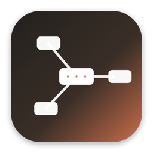
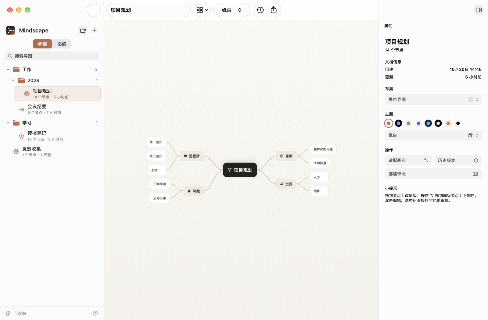
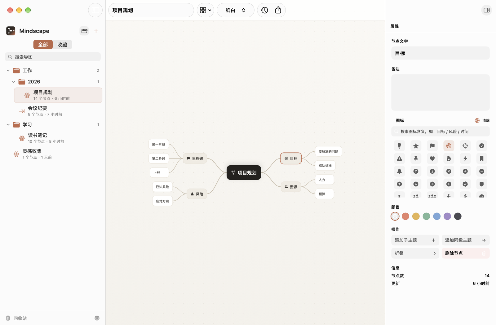
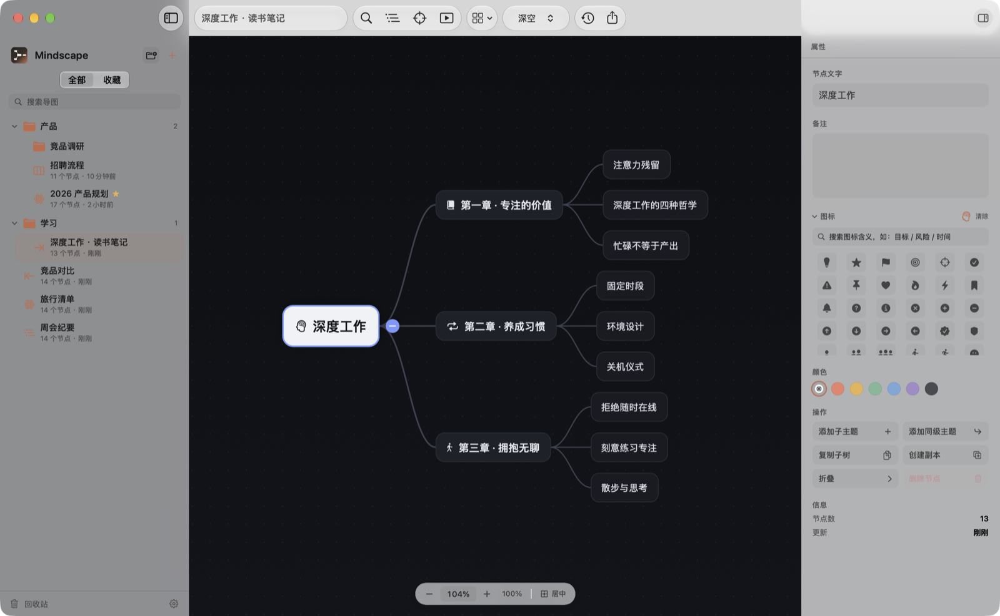
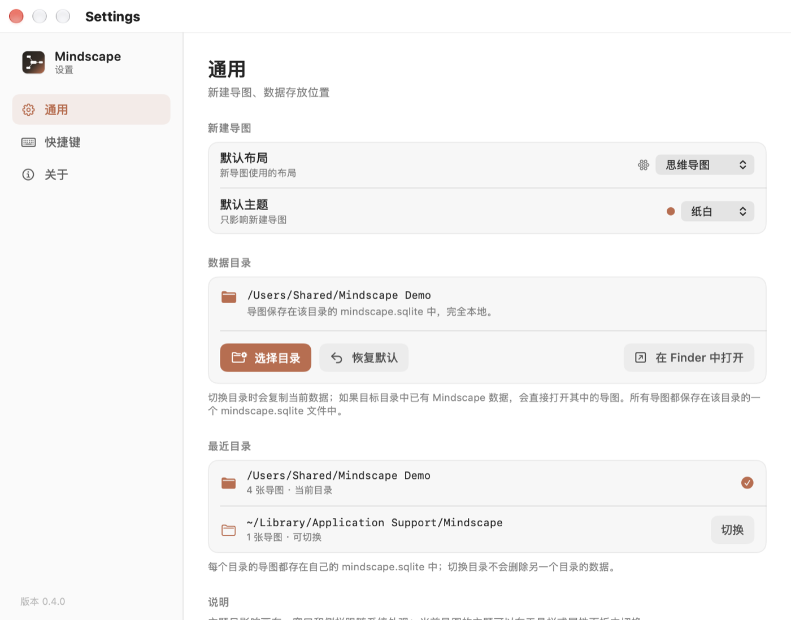
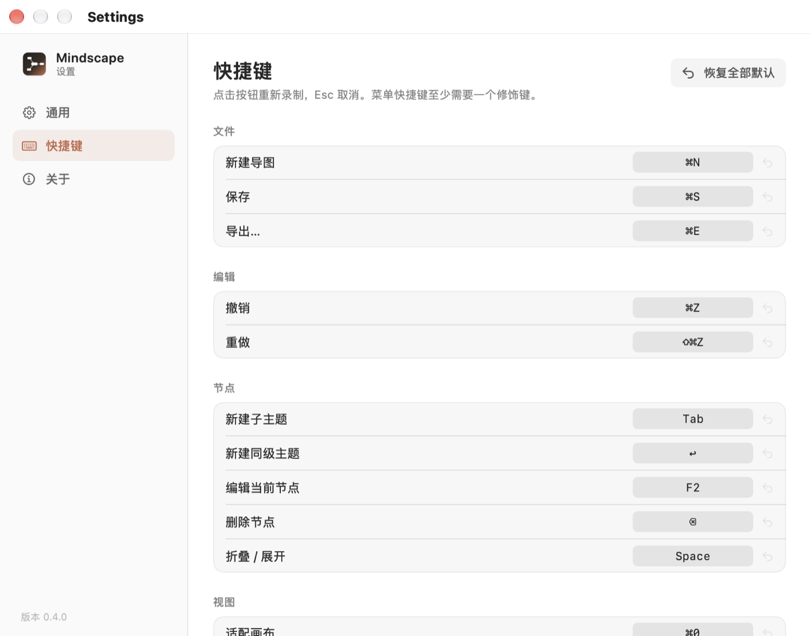
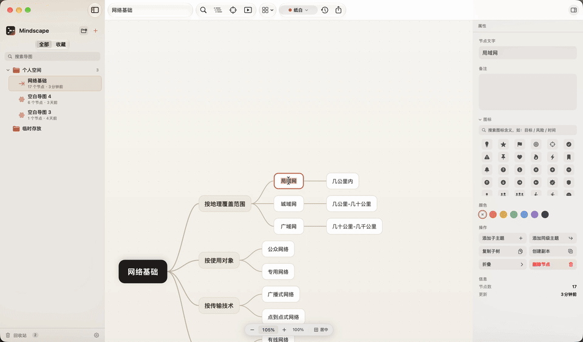

# Mindscape

<p align="center">
  
</p>

<p align="center">
  <strong>本地优先的 macOS 思维导图</strong><br>
  SwiftUI · AppKit · SQLite · 零第三方依赖
</p>

<p align="center">
  
  
  
  
  
  
  
</p>

<p align="center">
  <strong>中文</strong> · <a href="README.en.md">English</a> · <a href="https://jiuxianzai.github.io/Mindscape/">官网</a>
</p>

> A local-first mind map app for macOS. All data lives in a local SQLite file — no account, no cloud, no telemetry.

Mindscape 是一个纯本地的 macOS 思维导图应用：打开即画，数据全部保存在本机。它没有登录、没有云同步、不依赖任何第三方库；默认不联网，只有手动检查更新或在设置里开启自动检查时才会访问 GitHub。

当前版本：**0.5.3**（早期版本，功能和数据结构仍可能调整）

---

## 截图

截图使用示例数据；部分截图来自 0.5.x 早期版本，快捷键与界面细节以当前版本为准。

<p align="center">
  
</p>

<p align="center">
  
  
</p>

<p align="center">
  
  
</p>

<p align="center">
  
</p>

<p align="center">
  
</p>

---

## 为什么是 Mindscape

- **本地优先**：所有导图在一个 SQLite 文件里，断网可用，不登录，不上传。
- **原生性能**：画布是自绘 `NSView`，不是 Web/Electron；大图缩放、拖拽仍然跟手，整个 app 只有 3.9 MB。
- **中文输入法友好**：用拼音组字时节点随着候选实时变宽，不会「先折行再弹回」，候选框始终贴着光标——这是 Web 画布类思维导图最常翻车的地方。
- **动效克制**：折叠/展开按层级错峰落位，残影淡出、控件跟随淡入，不做“整屏闪跳”。
- **开箱好看**：8 套主题、8 种布局、现代留白与陶土色视觉，不需要自己调样式。
- **真的能整理**：多级目录、大纲视图、全图搜索、专注模式、收藏、回收站。
- **能带走**：PNG、PDF、Markdown、OPML、JSON 五种导出，也能导入 Markdown / OPML / JSON。

---

## 功能

### 画布

- 无限画布：双指平移、捏合缩放、⌘ + 滚轮缩放、⌘0 适配
- 节点：新增、重命名、折叠、多选、拖动、复制剪切粘贴、创建副本
- 支持多个头部节点；双击空白处新建头部节点并进入编辑
- 拖动改层级：拖到节点上挂到它下面；按住 ⌥ 拖到同级节点可调整顺序
- 画布快捷键：Space 进入编辑，Enter 新建同级节点（头部节点则新建头部），Tab 新建子节点
- 新增 / 编辑节点时按当前缩放自动居中，节点不断变大也不会跑出视口
- 导图标题默认跟随第一个头部节点的文字；手动改过标题后不再自动覆盖
- 多行就地编辑：Space / 双击 / 选中后直接打字
  - 进入编辑不跳动，字号与画布严格一致（任何缩放比例）
  - 节点随内容扩展，长文本自动换行，左右内边距对称
  - 中文输入法组字时节点实时变宽，不再“先折行再弹回”，候选框始终贴着光标
- 编辑时 `Enter` 提交，`Shift+Enter` 换行，`Esc` 取消并恢复
- 方向键在节点之间跳转，跨出视口时做最小幅度平移
- 浏览器式搜索条：⌘F 输入即高亮匹配节点，↑↓ 逐个跳转，已匹配数量实时显示
- 缩放条：底部常驻显示百分比，可直接点击档位或输入数值
- 分支缩放：⇧⌘B 只把当前分支放大到合适比例
- 专注模式：⇧⌘F 只保留当前分支，其余节点变淡

### 折叠

- 悬停节点即出现折叠控件，不用先点选
- 折叠后控件变成**常驻的数字圆**，直接显示里面藏了多少个节点
- 点击数字圆展开（和「+/−」共用同一命中区域，不必先选中）
- 快速连点不会被系统双击判定吞掉，每一次点击都翻转
- 折叠控件有手型指针与高亮反馈；动画期间命中判定跟随当前可见帧
- 分层错峰动画：父节点先动，子节点按深度依次跟上（每层 20ms，最多 2 层）
- 残影淡出被压在真实节点之下，不会出现“字叠字”

### 布局（8 种）

- 思维导图（左右平衡，按完全展开时的高度分侧，折叠不会换边）
- 逻辑图（右 / 左）
- 组织架构图
- 树形图
- 时间轴
- 括号图
- 自由布局（拖动时显示对齐辅助线，自动吸附）

### 主题（8 套）

纸白、深空、莫兰迪、商务蓝、蓝图、霓虹、暖砂、墨线。

主题只影响画布；窗口和侧栏跟随系统外观。当前导图的主题可以在工具栏或属性面板切换。

### 图标

- 102 个 SF Symbols（系统图标库，无第三方依赖）
- 按中文/英文含义搜索，如「目标」「风险」「时间」「goal」
- 可滚动浏览、可收起，不一次性占满属性面板
- 节点图标按主题文字色自动着色

### 大纲视图

- ⇧⌘O 在画布左侧打开大纲面板，按层级列出全部节点
- 点击条目跳转并定位到画布，折叠状态与画布双向一致
- 适合长图快速定位，和画布共享同一份模型

### 演示模式

- ⇧⌘P 打开独立演示窗口，按一级分支自动生成分页
- 每一页保留导图上下文，适合会议讲解与评审

### 文件树

- 多级目录，支持新建、子目录、重命名、删除
- 删除目录时内容自动上移到上一级，不丢数据
- 文档可拖到目录归档，也可以右键「移动到」
- 收藏、搜索、回收站、恢复、彻底删除

### 数据与历史

- SQLite 自动保存（600ms 防抖）
- 撤销 / 重做 150 步
- 手动快照 + 每 10 分钟自动快照
- 历史版本回滚，回滚前自动留档
- 数据目录可更换，设置里保留「最近目录」，可一键切回
- 每个目录的导图存在该目录自己的 `mindscape.sqlite` 中

### 导入导出 / 分享

- 导出：PNG（1x / 2x / 3x）、PDF（矢量）、Markdown 大纲、OPML、JSON
- 导入：Markdown、OPML、JSON（⇧⌘I，或菜单「文件 → 导入 Markdown / OPML…」）
- 导入总是生成新的文档，不会覆盖已有导图
- 系统分享：AirDrop、邮件、信息等
- 目录右键「导出为」可快速保存单张导图

### 无障碍与语言

- 画布节点暴露为 VoiceOver 元素，可读出层级、折叠状态和备注
- 界面中英双语，跟随系统语言切换

### 快捷键

- 设置页按分类管理，可逐个重新录制
- 菜单快捷键至少需要一个 ⌘ / ⌥ / ⌃ 修饰键
- 冲突检测、单项恢复默认、全部恢复默认

### 菜单栏

常驻菜单栏图标，支持：

- 打开 Mindscape
- 快速新建导图
- 从模板新建
- 最近导图
- 清空回收站（带确认）
- 设置
- 在 Finder 中打开数据目录
- 退出

---

## 从 XMind / FreeMind 迁移

目前还不能直接读 `.xmind` 文件，但 **OPML 是现成的桥**——XMind、MindNode、FreeMind 都能导出它。

**从 XMind 来**

1. 在 XMind 里打开导图，选 **文件 → 导出 → OPML**。
2. 回到 Mindscape，按 ⇧⌘I（或菜单 **文件 → 导入 OPML…**）选中刚导出的文件。

**从 FreeMind / Freeplane 来**

1. **文件 → 导出 → OPML**（Freeplane 里是 **文件 → 导出 → OPML**）。
2. 同样用 ⇧⌘I 导入。

**从 Markdown / Obsidian 来**

任何有层级的 Markdown 大纲都能直接 ⇧⌘I 导入，标题层级和列表缩进会转成节点层级。

几点说明：

- 导入**总是生成新文档**，不会覆盖或修改你已有的导图，可以放心试。
- OPML 只带结构和文字，备注、图标、关系线、概要不会跟过来——迁移大批量之前先拿一份小的验证一遍。
- 直接导入 `.xmind` 在路线图里（FreeMind / XMind 导入）。

---

## 安装

### 下载

从 [Releases](https://github.com/jiuxianzai/Mindscape/releases) 下载 `Mindscape-0.5.3.dmg`，打开后把 Mindscape 拖进 Applications。

应用内也可以检查更新：**设置 → 关于 → 检查更新**，或菜单栏的「检查更新…」。下载完成后会校验 SHA-256 并打开 DMG，仍然需要手动拖进 Applications 覆盖旧版本。

当前构建为 **ad-hoc 签名**，没有 notarization。首次打开如果被 Gatekeeper 拦下：

```bash
xattr -dr com.apple.quarantine /Applications/Mindscape.app
```

### 从源码构建

环境要求：

- macOS 14 或更高
- Xcode 15 或更高
- [XcodeGen](https://github.com/yonaskolb/XcodeGen)

```bash
brew install xcodegen

make run        # 生成工程、编译、启动
# 或
xcodegen generate
open Mindscape.xcodeproj
```

打包与本地安装：

```bash
make package    # 生成 dist/Mindscape-0.5.3.dmg、.zip 和 .dmg.sha256
make publish    # 用 gh 创建 GitHub Release（需已 gh auth login）
make install    # 安装到 /Applications 并启动
```

测试：

```bash
xcodebuild test -project Mindscape.xcodeproj -scheme Mindscape -derivedDataPath build
```

---

## 数据与隐私

默认数据目录：

```
~/Library/Application Support/Mindscape/mindscape.sqlite
```

- 所有导图保存在**一个 SQLite 文件**里，不是每个导图一个文件
- 可以在「设置 → 通用 → 数据目录」更换位置
- 「最近目录」会列出用过的目录、导图数量和切换按钮
- 切换目录不会删除原目录的数据
- 默认不联网；只有检查更新时访问 GitHub（可在 设置 → 通用 开启或关闭自动检查），没有遥测、没有账号

数据库表：

- `documents`：文档元信息 + 完整导图 JSON + 所属目录
- `folders`：目录树
- `snapshots`：历史快照 JSON
- `settings`：预留键值配置

---

## 默认快捷键

| 操作 | 快捷键 |
|---|---|
| 新建导图 | ⌘N |
| 导入 Markdown / OPML | ⇧⌘I |
| 保存 | ⌘S |
| 导出 / 分享 | ⌘E |
| 新建子主题 | Tab |
| 新建同级主题 / 新头部 | ↩ |
| 编辑当前节点 | Space / 双击 / 直接打字 |
| 删除节点 | Delete |
| 折叠 / 展开 | F3 |
| 创建副本 | ⌘D |
| 移动选择 | 方向键 |
| 撤销 / 重做 | ⌘Z / ⇧⌘Z |
| 查找节点 | ⌘F |
| 适配画布 | ⌘0 |
| 放大 / 缩小 | ⌘= / ⌘- |
| 缩放到分支 | ⇧⌘B |
| 专注当前分支 | ⇧⌘F |
| 折叠全部子分支 | ⇧⌘C |
| 展开全部 | ⇧⌘E |
| 显示 / 隐藏大纲 | ⇧⌘O |
| 演示模式 | ⇧⌘P |
| 显示 / 隐藏属性面板 | ⌥⌘I |
| 历史版本 | ⇧⌘H |

以上都可以在「设置 → 快捷键」中修改。

---

## 技术栈

| 层 | 实现 |
|---|---|
| UI | SwiftUI + AppKit |
| 画布 | 自绘 `NSView` + Core Graphics |
| 图标 | SF Symbols |
| 数据 | 系统 `libsqlite3`，WAL 模式 |
| 工程 | XcodeGen（`project.yml`） |
| 测试 | XCTest（67 个用例，含画布交互与渲染回归） |
| 最低系统 | macOS 14 |
| 架构 | Universal（arm64 + x86_64） |
| 第三方依赖 | 无 |

## 设计约定

- **画布自绘**：节点与连线走 Core Graphics，缩放时直接变换坐标系，避免大量 SwiftUI 视图带来的性能问题。
- **布局是纯函数**：`MindMap -> LayoutResult(frames, bounds)`，画布、演示和导出复用同一份结果。
- **编辑状态集中**：`MapEditor`（`@Observable`）负责编辑、撤销、自动保存；画布、属性面板、大纲、工具栏都读写它。
- **屏幕即真相**：动画期间命中测试用当前可见帧（`displayFrames`），而不是过渡终点，避免“看得见点不到”。
- **一个目录一个库**：文档主体存 JSON，列表/搜索所需的标题、布局、主题、节点数、目录冗余成列。
- **本地优先**：默认不联网，只有检查更新会访问 GitHub；没有账号系统，没有遥测。

---

## 项目结构

```
Mindscape/
├── project.yml                 # XcodeGen 工程描述
├── Makefile                    # build / run / package / install
├── CHANGELOG.md                # 版本记录
├── LICENSE                     # MIT
├── SECURITY.md                 # 安全披露说明
├── docs/screenshots/           # README 截图
├── Mindscape/
│   ├── App/                    # 入口、全局状态、菜单命令
│   ├── Models/                 # 节点 / 文档 / 布局 / 主题 / 模板 / 图标目录
│   ├── Storage/                # SQLite 封装、文档与目录仓库
│   ├── Editor/                 # MapEditor：编辑、撤销、自动保存、剪贴板
│   ├── Canvas/                 # 布局引擎、测量、渲染、命中测试、动画、无障碍
│   ├── Presentation/           # 演示模式的独立窗口
│   ├── Views/                  # 侧栏、工作区、大纲、属性面板、导出、设置、菜单栏
│   ├── Support/                # 颜色、相对时间、快捷键、导入导出、本地化
│   ├── en.lproj/               # 英文本地化
│   └── Assets.xcassets/        # AppIcon / BrandMark
└── MindscapeTests/             # XCTest：模型、布局、画布交互、渲染回归
```

---

## 路线图

- [x] 导入 Markdown / OPML / JSON
- [x] 大纲视图与画布定位
- [x] 演示模式、专注模式
- [x] 自由布局对齐吸附
- [x] XCTest 测试 target
- [ ] FreeMind / XMind 导入
- [ ] 大纲与画布双向编辑同步
- [ ] 关系线、概要、边界框
- [ ] 图片 / 附件节点
- [ ] FTS5 全文搜索
- [ ] 正式签名、notarization
- [ ] CI（构建 + 测试 + 发布）
- [ ] 稳定 1.0 数据格式

## 已知限制

- 导入只支持 Markdown、OPML 和 Mindscape 自己的 JSON，还不支持 FreeMind / XMind（XMind 用户可先导出 OPML，见「从 XMind / FreeMind 迁移」）
- 大纲视图目前只读（可定位，不能在大纲里改字）
- 没有关系线、概要、边界框、图片 / 附件节点
- 自由布局需要手动摆放，只做对齐吸附，没有自动整理
- 目录本身还不能拖动排序
- 演示模式按一级分支自动分页，不能手动调整顺序
- 当前是 ad-hoc 签名，只适合本机与内部分发

---

## 贡献

欢迎 issue 和 PR。

- 提交前请先开 issue 描述问题或改动，避免重复工作
- 开发用 `make run`，打包用 `make package`，改完请跑一遍测试
- 项目刻意保持零第三方依赖；新增依赖前请先讨论
- 代码风格保持现有的分层：Models / Storage / Editor / Canvas / Views
- 涉及画布交互的改动，请补一条能复现问题的 XCTest（本项目多数 bug 是这样锁住的）

---

## 更新日志

见 [CHANGELOG.md](CHANGELOG.md)。

## License

本项目使用 [MIT License](LICENSE)。

## 致谢

- [SF Symbols](https://developer.apple.com/sf-symbols/)：系统图标库
- [SQLite](https://www.sqlite.org/)：本地存储
- SwiftUI / AppKit：原生界面与画布
