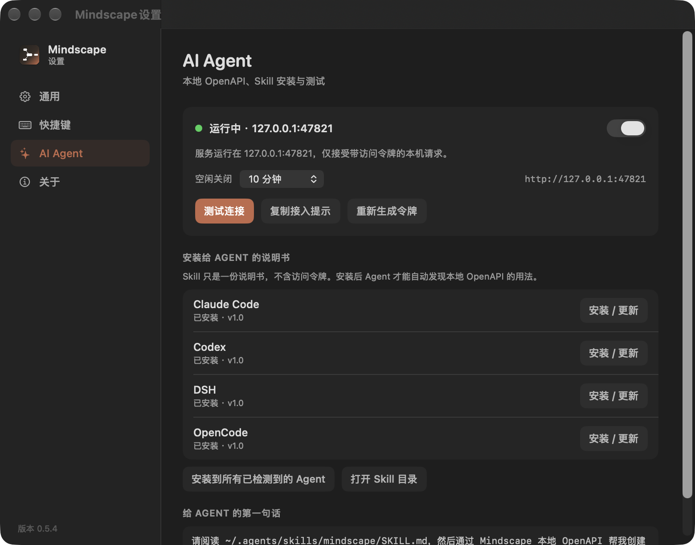
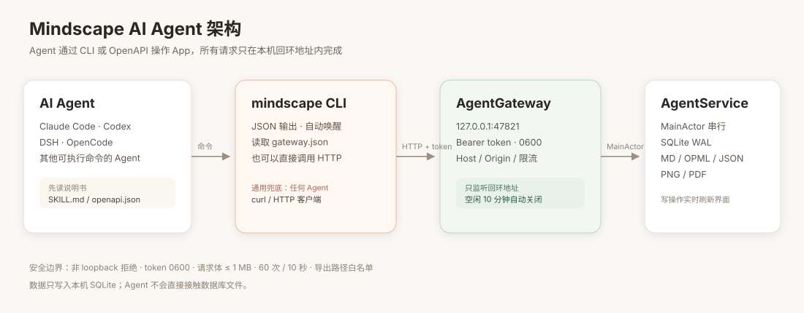
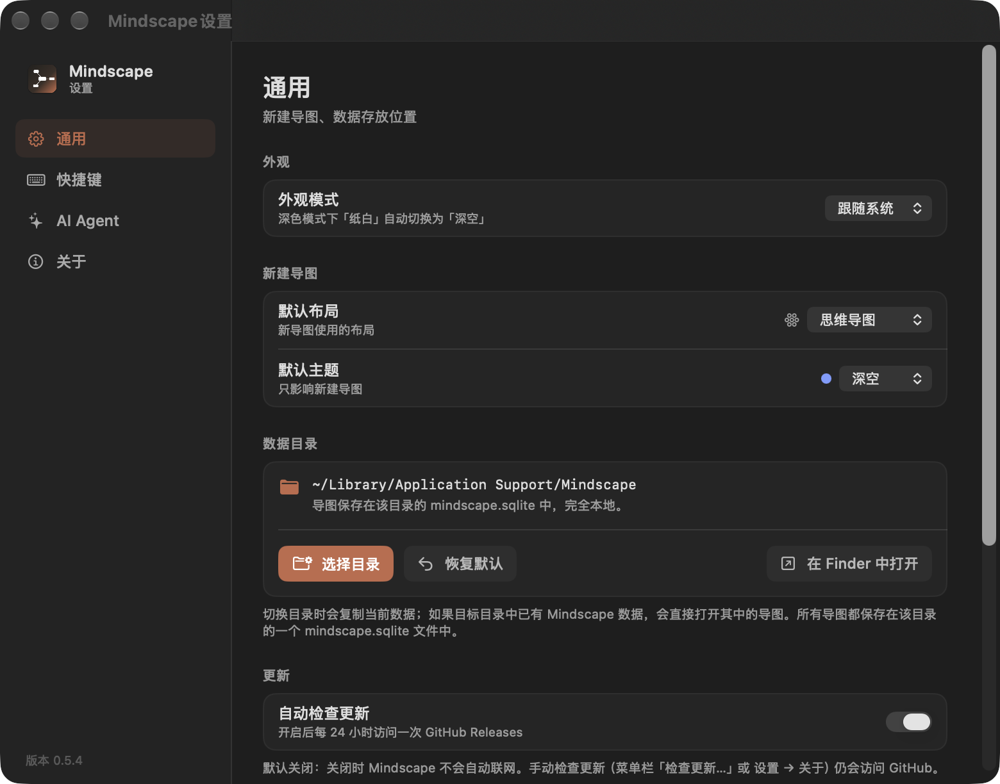
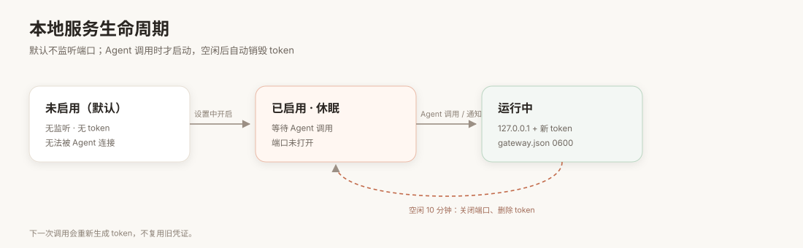

# 让 AI Agent 操作 Mindscape

> 适用：菜单中出现「AI Agent 接入…」的 Mindscape 版本。
> 目标：让本机的 Claude Code、Codex、DSH、OpenCode 或任意能执行命令的 Agent，通过本地 OpenAPI 创建、编辑、导出思维导图。

<p align="center">
  
</p>

---

## 它是什么

Mindscape 在 App 内起一个**只监听本机回环地址**的 OpenAPI 服务。Agent 不直接改 SQLite，而是通过网关操作；因此：

- 单一写者，不会和 App 抢数据库
- Agent 改完，界面实时刷新
- 导出复用 App 的 PNG / PDF 渲染
- 默认关闭，Agent 调用时才启动，空闲自动关闭

<p align="center">
  
</p>

### 能做什么

- 创建、重命名、移动、删除目录
- 创建导图，选择布局、主题、模板
- 增删改节点：文字、备注、图标、颜色、折叠、层级
- 批量创建/修改节点（一次最多 500 个操作，保存一次）
- 导出 Markdown / OPML / JSON / PNG / PDF
- 导入 Markdown / OPML / JSON

---

## 三步接入

首次启动会依次询问「是否自动检查更新」和「是否一键安装 Agent Skill」，两项都默认关闭。选择安装后会直接给出一段可复制的提示。

### 第一步：打开开关

打开 **设置**，在左侧选择 **AI Agent**，启用「允许本地 AI Agent 操作」。

<p align="center">
  
</p>

默认是关闭的。开启后也不会立刻常驻监听：只有 Agent 调用时才启动；空闲 10 分钟自动关闭。

### 第二步：安装 Skill

点菜单栏「**AI Agent 接入…**」会直接打开 **设置 → AI Agent**；点「安装 / 更新」：

<p align="center">
  
</p>

| Agent | 安装位置 | 说明 |
|---|---|---|
| Claude Code | `~/.claude/skills/mindscape/SKILL.md` | 自动发现 |
| Codex | `~/.codex/AGENTS.md` 受管段落 | 指向 `~/.agents/skills/mindscape/SKILL.md` |
| DSH | `~/.dsh/skills/mindscape/SKILL.md` | 自动发现 |
| OpenCode | `~/.config/opencode/skills/mindscape/SKILL.md` | 若该目录存在；否则用 `~/.agents/skills` |

安装只复制说明书，**不包含 token**。token 是每次服务启动时临时生成的。

### 第三步：对 Agent 说一句话

在面板里点「复制接入提示」，或者直接复制：

```text
请阅读 ~/.agents/skills/mindscape/SKILL.md，然后通过 Mindscape 本地 OpenAPI 帮我创建一张项目规划导图。
```

也可以更自然地说：

```text
用 Mindscape 把「Q4 规划」整理成一张思维导图，包含目标、里程碑、风险三个分支，最后导出 Markdown 到 ~/Downloads/q4.md。
```

Agent 首次执行 shell 命令或访问本机服务时，可能会向你请求权限；允许后它会先 `mindscape health`，再创建导图。

---

## 没有预置的 Agent 怎么办

不需要等适配，两条路都能用：

### 方式 A：复制 Skill 文件夹

1. 在「AI Agent 接入…」点「打开 Skill 目录」
2. 把 `mindscape` 文件夹复制到该 Agent 的 skills/rules 目录
3. 把上面的「请阅读…」提示发给它

如果 Agent 只支持 `AGENTS.md`，把那句话写进 `AGENTS.md` 也可以。

### 方式 B：直接用 CLI 或 HTTP

Agent 只要能在终端执行命令，就能用：

```bash
mindscape health
mindscape map create "临时导图"
mindscape node add <map-id> --parent <root-id> --text "想法"
```

或者读取网关描述文件后直接发 HTTP：

```bash
cat "$HOME/Library/Application Support/Mindscape/agent-gateway.json"
```

返回的 `url` 和 `token` 用于 `Authorization: Bearer <token>`。完整接口见 [openapi.json](../AgentSkill/openapi.json)。

---

## 安装/使用 CLI

CLI 不是必须的，但强烈推荐：它负责唤醒服务、读取 token、输出 JSON，Agent 不用自己处理端口。

```bash
# 在仓库目录
make install-cli PREFIX=$HOME/.local/bin
```

确认：

```bash
mindscape health
mindscape guide
```

常用命令：

```bash
mindscape folder create "项目 A"
mindscape map create "Q4 规划" --template project
mindscape map list
mindscape map show <map-id>
mindscape map tree <map-id>

mindscape node add <map-id> --parent <node-id> --text "目标"
mindscape node set <map-id> <node-id> --text "新标题" --note "备注"
mindscape node move <map-id> <node-id> --parent <node-id>
mindscape node delete <map-id> <node-id>

mindscape map export <map-id> --format md --out ~/Downloads/q4.md
mindscape map export <map-id> --format png --out ~/Downloads/q4.png
```

所有命令输出 `{"ok":true,"data":...}` 或 `{"ok":false,"error":...}`，方便 Agent 解析。

---

## 生命周期与安全

<p align="center">
  
</p>

| 保护 | 行为 |
|---|---|
| 默认关闭 | 不开启开关就完全无法连接 |
| 只监听本机 | `127.0.0.1`，非 loopback 连接失败 |
| 临时 token | 每次启动生成，写入 `agent-gateway.json`（0600），关闭时删除 |
| 请求校验 | Host 必须是本机；带浏览器 `Origin` 的请求拒绝 |
| 体积/频率 | 请求体 ≤ 1 MB；每 10 秒最多 60 次；并发 8 |
| 路径白名单 | 导出/导入只允许用户目录或 `/tmp`，扩展名必须匹配 |
| 空闲关闭 | 默认 10 分钟没有请求就关闭端口并删除 token |

App 不需要一直开着窗口，但进程必须在运行。CLI 会在服务未启动时尝试唤醒；如果 App 未安装或未启用，会给出明确错误。

---

## 外观设置

**设置 → 通用 → 外观** 提供「跟随系统 / 浅色 / 深色」。深色下「纸白」会自动切换为「深空」，避免浅色画布与黑色侧栏并排割裂；切回浅色后可以重新选择纸白。

## 常见问题

| 现象 | 原因 | 处理 |
|---|---|---|
| `401 Unauthorized` | token 已轮换/服务重启 | 重新执行命令；必要时在面板点「重新生成令牌」 |
| `403 invalid_host` / `browser_origin` | 不是从本机 CLI 发起的请求 | 用 `mindscape` 或在 `127.0.0.1` 上直接请求 |
| `503` / 连接失败 | 开关未开，或 App 未运行 | 打开 App → 设置 → AI Agent；再试 |
| `mindscape: command not found` | CLI 未安装或不在 PATH | `make install-cli PREFIX=$HOME/.local/bin`，确认 PATH |
| Agent 找不到 skill | 该 Agent 未重启 / 路径不对 | 重启 Agent；核对表格里的安装位置；或直接粘贴提示词 |
| 端口被占用 | 47821 被其他程序占用 | 服务会自动换端口，以 `agent-gateway.json` 的 `url` 为准 |
| 删除/覆盖前被 Agent 询问 | Skill 的安全规则 | 确认目标后再允许；这是预期行为 |

---

## 更新与卸载

**更新 Skill**：App 升级后打开「AI Agent 接入…」，若显示「可更新」，点「安装 / 更新」。也可以直接点「安装到所有已检测到的 Agent」。

**卸载**：

- Claude Code：删除 `~/.claude/skills/mindscape`
- DSH：删除 `~/.dsh/skills/mindscape`
- Codex：删除 `~/.codex/AGENTS.md` 中 `<!-- mindscape:agent-skill:begin -->` 到 `end` 的段落
- OpenCode：删除 `~/.config/opencode/skills/mindscape`；若使用 `AGENTS.md` 方式，删除对应受管段落
- 公共副本：删除 `~/.agents/skills/mindscape`
- CLI：删除 `~/.local/bin/mindscape`

---

## 给 Agent 的说明书

- [SKILL.md](../AgentSkill/SKILL.md)：Agent 的操作手册（工作流、安全规则、命令示例）
- [openapi.json](../AgentSkill/openapi.json)：OpenAPI 3.1 接口定义
- 运行时：`GET /v1/skill.md`、`GET /v1/openapi.json`
